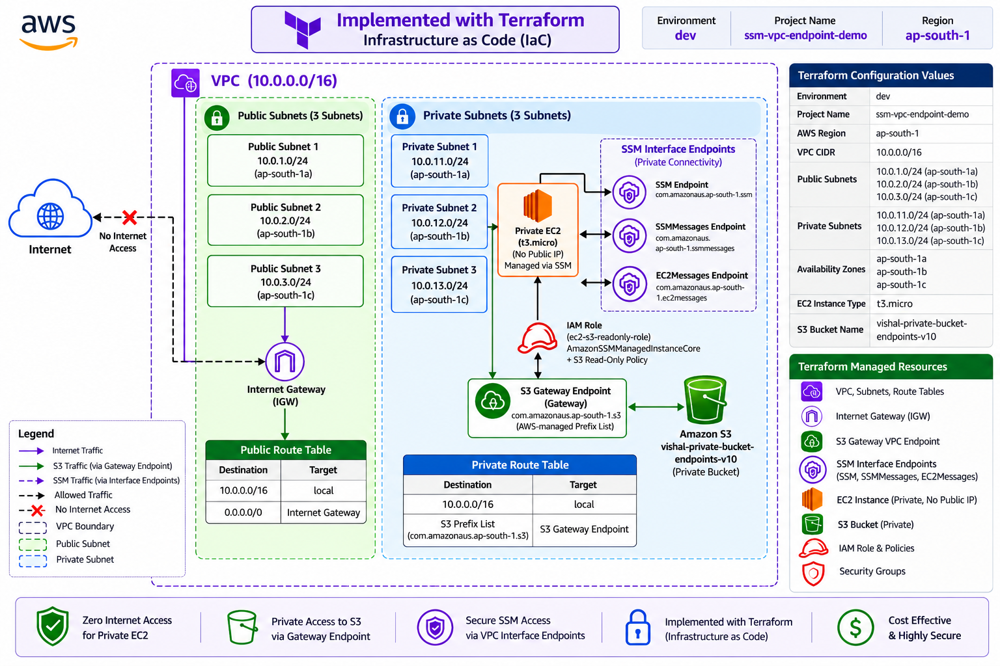

# 🔐 Secure Zero-Internet AWS Architecture with Terraform

> **Private EC2, S3 Gateway VPC Endpoint, and AWS Systems Manager (SSM)
> --- provisioned using Terraform Infrastructure as Code (IaC).**

This project demonstrates how to build a secure AWS environment in which
an EC2 instance runs in a private subnet without a public IP address or
direct internet access, accesses Amazon S3 through an S3 Gateway VPC
Endpoint, and is managed using AWS Systems Manager.

The infrastructure is implemented with **Terraform**, making the network
and supporting AWS resources repeatable and easier to maintain.

------------------------------------------------------------------------

## 📌 Project Overview

The project implements a private AWS architecture with these
capabilities:

-   A custom VPC with public and private subnets across three
    Availability Zones.
-   A private EC2 instance with no public IP address.
-   An S3 Gateway VPC Endpoint for private EC2-to-S3 connectivity.
-   AWS Systems Manager (SSM) interface endpoints for private instance
    management.
-   IAM roles and policies for controlled EC2 access to S3 and Systems
    Manager.
-   Security groups and route tables to control network traffic.
-   Terraform-managed infrastructure rather than manual console-based
    resource creation.

The private EC2 instance does not need a NAT Gateway or an internet
route for S3 access through the S3 Gateway Endpoint. SSM connectivity
depends on the configured interface endpoints, endpoint security groups,
IAM permissions, and a functioning SSM Agent.

------------------------------------------------------------------------
## Architecture Diagram



------------------------------------------------------------------------

## 🎯 Project Goals

-   Provision AWS infrastructure using Terraform (IaC).
-   Build a custom VPC with public and private subnet tiers.
-   Deploy a private EC2 instance without a public IP.
-   Access S3 privately through an S3 Gateway VPC Endpoint.
-   Manage the private EC2 instance using AWS Systems Manager Session
    Manager.
-   Apply least-privilege IAM permissions where practical.
-   Configure route tables, endpoint associations, and security groups.
-   Validate private S3 access and SSM connectivity.

------------------------------------------------------------------------

## 🏗️ Architecture

### Architecture Diagram

Save the updated architecture image in your repository as
`architecture/architecture-diagram.png` so the following image link
works on GitHub.


### S3 Traffic Flow

``` text
Private EC2
    |
    v
Private Route Table
    |
    v
S3 Prefix List Route
    |
    v
S3 Gateway VPC Endpoint
    |
    v
Amazon S3
```

### SSM Management Flow

``` text
AWS Console / Session Manager
    |
    v
SSM Interface VPC Endpoints
    |
    v
Private EC2 (no public IP)
```

The S3 Gateway Endpoint and SSM interface endpoints serve different
purposes: the gateway endpoint provides private routing to S3, while the
interface endpoints provide private connectivity to Systems Manager
services.

------------------------------------------------------------------------

## ☁️ Terraform Implementation

Terraform is used to define and provision the infrastructure as code.

### Terraform-managed components

-   VPC and subnet configuration
-   Public and private route tables and subnet associations
-   Internet Gateway for the public subnet tier
-   S3 Gateway VPC Endpoint
-   SSM interface VPC endpoints
-   Private EC2 instance
-   EC2 IAM role and instance profile
-   IAM policies and policy attachments
-   Security groups
-   Private S3 bucket and test object

### Example Terraform workflow

Run these commands from the appropriate Terraform environment directory:

``` bash
terraform init
terraform fmt -recursive
terraform validate
terraform plan
terraform apply
```

Review the plan before applying. The exact command and working directory
depend on the repository's environment/module layout.

To remove resources when they are no longer needed, review the impact
and any retained data first, then use `terraform destroy` from the
correct environment directory. Do not destroy shared networking or a
shared state backend unintentionally.

------------------------------------------------------------------------

## 🌐 Network Configuration

### Environment

  Setting        Value
  -------------- -------------------------
  Environment    `dev`
  Project name   `ssm-vpc-endpoint-demo`
  AWS Region     `ap-south-1` (Mumbai)
  VPC CIDR       `10.0.0.0/16`

### Public Subnets

  Subnet            CIDR            Availability Zone
  ----------------- --------------- -------------------
  Public subnet 1   `10.0.1.0/24`   `ap-south-1a`
  Public subnet 2   `10.0.2.0/24`   `ap-south-1b`
  Public subnet 3   `10.0.3.0/24`   `ap-south-1c`

### Private Subnets

  Subnet             CIDR             Availability Zone
  ------------------ ---------------- -------------------
  Private subnet 1   `10.0.11.0/24`   `ap-south-1a`
  Private subnet 2   `10.0.12.0/24`   `ap-south-1b`
  Private subnet 3   `10.0.13.0/24`   `ap-south-1c`

### EC2 and S3 configuration

  Setting                    Value
  -------------------------- ---------------------------------------
  EC2 instance type          `t3.micro`
  S3 bucket name             `vishal-private-bucket-endpoints-v10`
  EC2 placement              Private subnet
  Public IP on private EC2   Disabled / not assigned

The EC2 instance's actual subnet, AMI, and security group should be
confirmed from the Terraform configuration and deployed state.

------------------------------------------------------------------------

## 🔒 Security Architecture

### Private EC2

The EC2 instance is deployed in a private subnet and is intended to
have:

-   No public IP address.
-   No direct internet route.
-   An attached IAM instance profile.
-   A security group allowing only required traffic.
-   Management through AWS Systems Manager Session Manager.

### Amazon S3

The project uses the private S3 bucket:

``` text
vishal-private-bucket-endpoints-v10
```

The private EC2 instance accesses the bucket through an S3 Gateway VPC
Endpoint. Keep S3 Block Public Access enabled unless a documented
requirement says otherwise.

### S3 Gateway VPC Endpoint

  Setting             Value
  ------------------- -------------------------------
  Endpoint type       Gateway
  AWS service         `com.amazonaws.ap-south-1.s3`
  Route association   Private route table(s)
  Routing target      AWS-managed S3 prefix list

The endpoint adds a route for the regional S3 prefix list to the
associated route table(s). S3 access is still controlled by IAM
policies, bucket policies, and any endpoint policy.

### AWS Systems Manager interface endpoints

The project uses these service endpoints in the Mumbai Region:

``` text
com.amazonaws.ap-south-1.ssm
com.amazonaws.ap-south-1.ssmmessages
com.amazonaws.ap-south-1.ec2messages
```

These endpoints support private communication with Systems Manager.
Endpoint security groups must permit the required HTTPS traffic from the
EC2 instance, and the instance needs appropriate IAM permissions and a
running SSM Agent.

### IAM

The EC2 instance profile supplies permissions to the instance without
embedding long-lived AWS access keys in the instance.

The project includes S3 access policy configuration and the
`AmazonSSMManagedInstanceCore` policy for Systems Manager management.
Limit S3 permissions to the required bucket and actions where practical.

------------------------------------------------------------------------

## 🛣️ Routing Overview

### Public route table

The public route table normally contains:

``` text
10.0.0.0/16  -> local
0.0.0.0/0    -> Internet Gateway
```

### Private route table

The private route table contains the local VPC route and the S3
prefix-list route:

``` text
10.0.0.0/16          -> local
S3 regional prefix list -> S3 Gateway VPC Endpoint
```

The private EC2 instance does not require a NAT Gateway for traffic
routed to S3 through the Gateway Endpoint. Do not add a default internet
route to the private route table unless the design specifically requires
it.

------------------------------------------------------------------------

## 🧪 Validation

After deploying the infrastructure, validate the resources and
connectivity.

### Terraform checks

``` bash
terraform fmt -check -recursive
terraform validate
terraform plan
terraform state list
```

### AWS checks

Confirm the EC2 instance has no public IP, the S3 Gateway Endpoint is
associated with the correct private route table(s), and the SSM
interface endpoints are available.

From the private EC2 instance connected through Session Manager, test
access to the intended S3 object. For example, after replacing the
object key with the actual key:

``` bash
aws s3 cp s3://vishal-private-bucket-endpoints-v10/OBJECT_KEY ./downloaded-file
```

A successful download confirms that the instance can access that object
with its current IAM and S3 policies. A successful SSM session confirms
management connectivity; these checks should be performed in the
deployed environment rather than assumed from the Terraform
configuration alone.

------------------------------------------------------------------------

## 📸 Implementation Screenshots

Add your actual screenshots to the `screenshots/` directory and update
the filenames below to match the files committed to your repository.

-   VPC and subnet configuration: `screenshots/01-vpc-and-subnets.png`
-   Route tables: `screenshots/02-route-tables.png`
-   S3 bucket: `screenshots/03-s3-bucket.png`
-   S3 Gateway Endpoint: `screenshots/04-s3-gateway-endpoint.png`
-   SSM interface endpoints:
    `screenshots/05-ssm-interface-endpoints.png`
-   Private EC2 instance: `screenshots/06-private-ec2.png`
-   IAM role and policies: `screenshots/07-iam-role-policies.png`
-   Session Manager connection: `screenshots/08-ssm-session.png`
-   S3 download validation: `screenshots/09-s3-download-validation.png`

Only keep image links for screenshots that are actually present in the
repository.

------------------------------------------------------------------------

## 🧰 AWS Services and Tools Used

-   Terraform (Infrastructure as Code)
-   Amazon VPC
-   Amazon EC2
-   Amazon S3
-   S3 Gateway VPC Endpoint
-   VPC Interface Endpoints
-   AWS Systems Manager (SSM)
-   AWS IAM
-   Internet Gateway
-   Route tables and security groups

------------------------------------------------------------------------

## 🔐 Security Highlights

-   Private EC2 instance without a public IP address.
-   Private S3 connectivity through an S3 Gateway Endpoint.
-   SSM-based management without requiring inbound SSH from the
    internet.
-   IAM role and instance profile for instance permissions.
-   Security groups and endpoint policies for controlled access.
-   Terraform-based, repeatable infrastructure configuration.
-   No NAT Gateway required solely for S3 access through the Gateway
    Endpoint.

------------------------------------------------------------------------

## 💰 Cost Considerations

-   S3 Gateway VPC Endpoints do not have the hourly endpoint charge
    associated with interface endpoints.
-   SSM interface endpoints can incur hourly and data-processing
    charges.
-   EC2, EBS, S3 storage/requests, public IPv4 addresses (if used
    elsewhere), and other resources may incur charges.
-   Review the deployed resources and AWS pricing for your Region.
    Destroy resources that are no longer required, while preserving any
    state or data you need.

------------------------------------------------------------------------

## 🎓 Key Learning Outcomes

Through this project, I practiced:

-   Writing and deploying AWS infrastructure with Terraform.
-   Configuring VPCs, public/private subnets, and route tables.
-   Using an S3 Gateway VPC Endpoint for private S3 access.
-   Using SSM interface endpoints to manage private EC2 instances.
-   Attaching IAM roles and policies to EC2.
-   Applying network isolation and least-privilege principles.
-   Validating infrastructure with Terraform and AWS CLI commands.
-   Troubleshooting AWS endpoint connectivity and Terraform
    state/backend access.

------------------------------------------------------------------------

## ✅ Conclusion

This project demonstrates a Terraform-managed AWS architecture designed
to keep an EC2 instance private while enabling S3 access through an S3
Gateway VPC Endpoint and instance management through AWS Systems
Manager.

It combines Infrastructure as Code, private networking, IAM-based
access, and VPC endpoints to reduce direct internet exposure and make
the environment repeatable.

------------------------------------------------------------------------

## 👨‍💻 Author

**Vishal Konde**

------------------------------------------------------------------------

⭐ If you find this project useful, consider giving the repository a
star.
